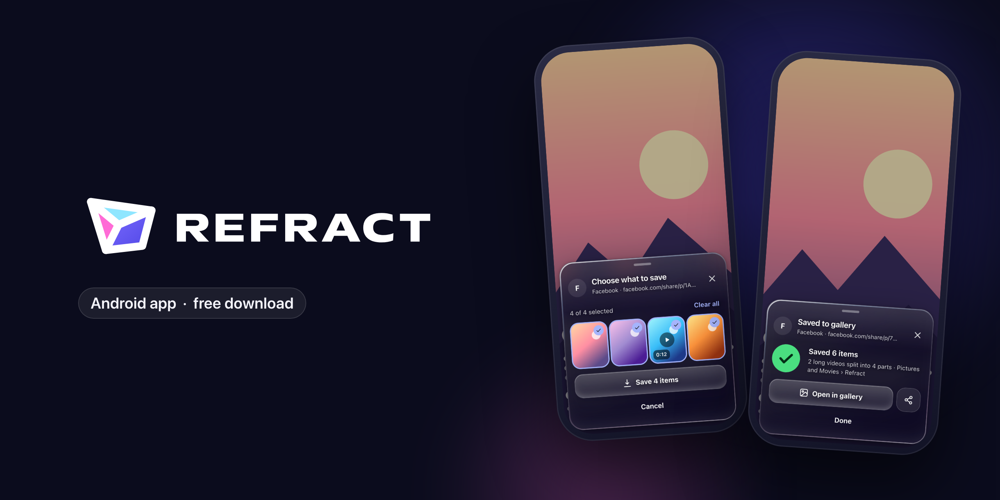
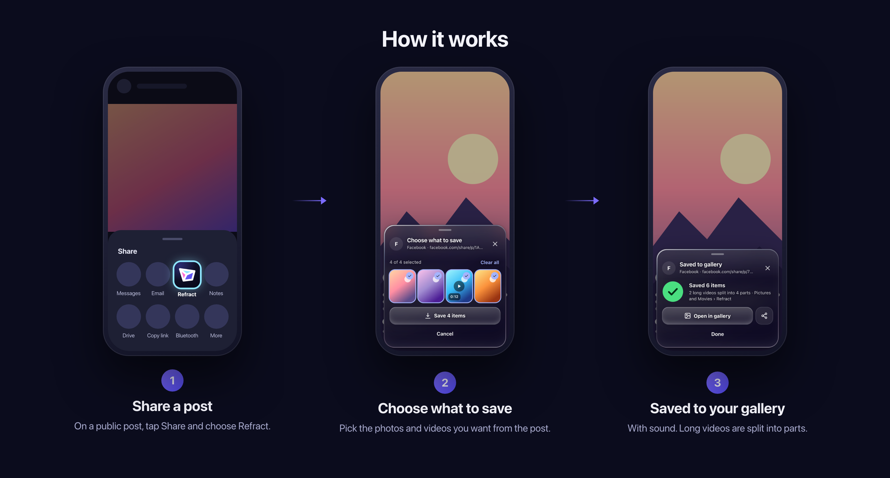
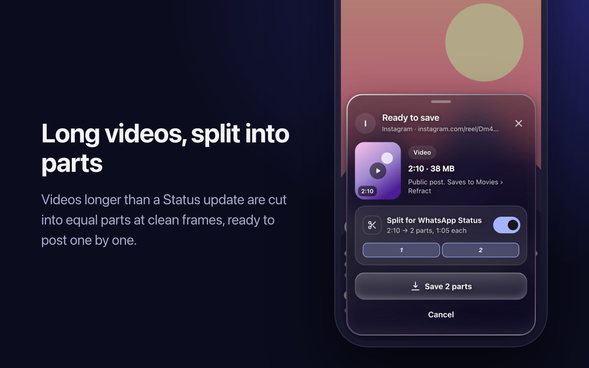
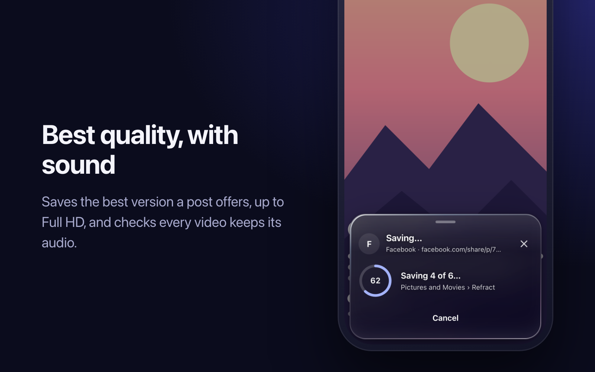
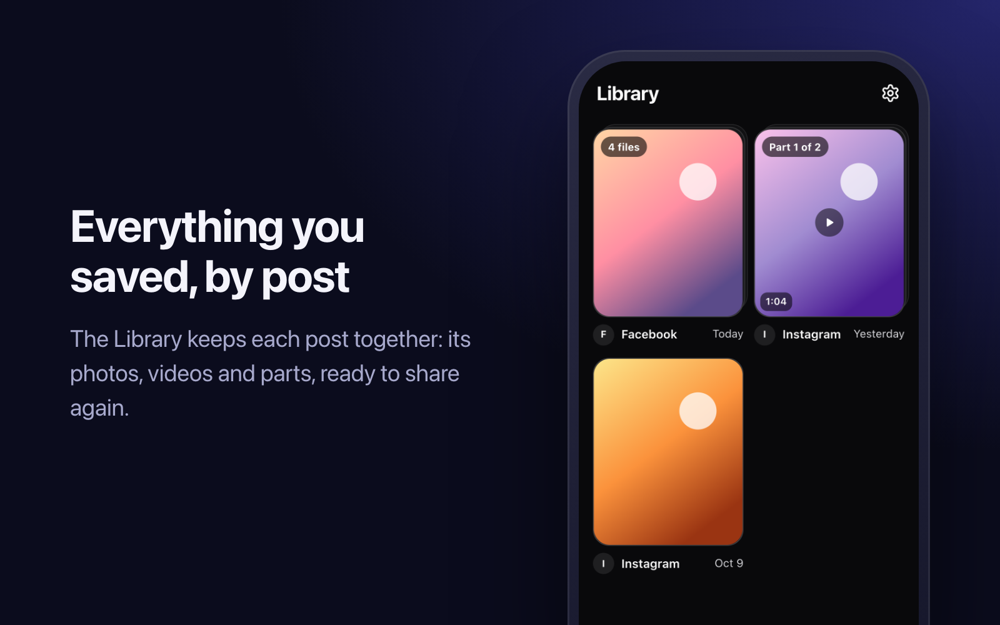
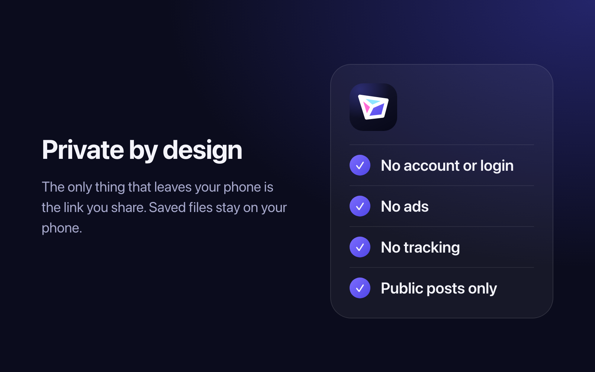

  <a href="https://github.com/hystericmoon/refract-releases/releases/latest/download/Refract.apk"><b>⬇ Download the latest APK</b></a>
  &nbsp;·&nbsp; Android 7.0 or later &nbsp;·&nbsp; about 2 MB &nbsp;·&nbsp; free

Refract saves photos and videos from public posts to your phone's gallery. Share a post to Refract, pick what you want, and it's saved, with sound, at the best quality the post offers.

## How it works

## Features

<table>
  <tr>
    <td width="50%"></td>
    <td width="50%"></td>
  </tr>
  <tr>
    <td width="50%"></td>
    <td width="50%"></td>
  </tr>
</table>

- **Carousels:** save the whole post, or tick just the photos and videos you want.
- **Long videos:** split into equal parts that fit a Status update. You pick the part length (15 s to 3 min).
- **Full HD (optional):** turn on Settings → Quality for 1080p on reels; it's slower.
- **Library:** every save, grouped by post, ready to open, share or remove.
- **Copied links:** optionally, Refract offers to save a post link you copied when you open it.
- Light and dark themes, reduced motion and reduced transparency, and screen-reader labels throughout.

Works with public posts from Instagram, Facebook and Threads. Refract is not affiliated with, endorsed by or sponsored by Meta Platforms, Inc. Save only what you have the right to use.

## Install

1. On your phone, tap **Download the latest APK** above, then open the downloaded file.
2. Android asks once to allow installs from the app you opened it with (Chrome, Files or WhatsApp). Allow it.
3. If Play Protect says the app is from an unknown developer, tap **Install anyway**. Refract isn't on Google Play; see the FAQ.

## Updating

Refract shows **Update available** in Settings → About when a new version is out. Tap it, download and install over the old one; your saves and settings stay. Every version is listed under [Releases](https://github.com/hystericmoon/refract-releases/releases).

## Check a download

Every release is signed with the same key. Signing certificate SHA-256:

`68:DE:FE:BB:B2:A5:8B:D3:40:F8:37:04:18:5A:E7:FF:D8:03:A5:C3:D6:A5:87:7E:6E:16:FF:C8:69:70:E5:84`

Each release also lists the SHA-256 of its APK file.

## Privacy

No account, no login, no ads, no tracking. The only thing that leaves your phone is the link you share, which is used to look up the post's media. Saved files and your Library stay on your phone. Full details: [privacy policy](https://socsaver-resolver.hosnirachmani.workers.dev/privacy).

Questions, or a request to remove content: hosnirachmani@gmail.com

## FAQ

**Why isn't it on Google Play?** Play often removes apps that save media from social networks, so Refract is distributed here for now.

**Can it save private posts or stories?** No. Refract only works with public posts, and never asks for your social media login.

**A save says "busy". What happened?** Refract uses free lookup services with a daily limit. Try again later; the limit resets every day.

**My video came out in parts.** That's the split for Status. Turn off Settings → Split videos → Auto-split long videos, or switch it off for one video in the sheet before saving.
